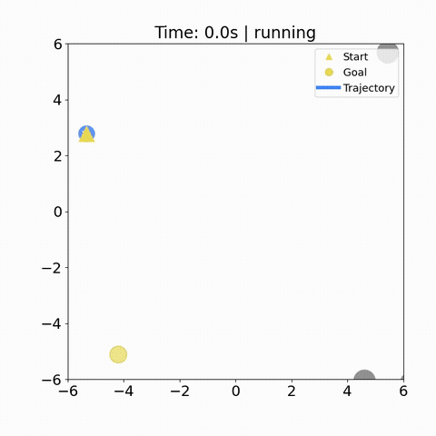

# diff_rl_safe



A JAX testbed for robot navigation through moving crowds, building on [DiffCVaR](https://arxiv.org/abs/2605.21257). Try the [interactive CrowdNav Playground](https://anonymousroboticsfan123.github.io/crowdnav-playground/) for a browser-based demonstration.

## Prerequisites

- **Virtual environment:** Micromamba or Conda.
- **GPU:** Linux and an NVIDIA GPU with a working driver. CUDA-enabled JAX is installed by GPU setup.
- **W&B (optional):** your own account for online training logs.

## Getting Started

Install and verify environments:

```bash
bash scripts/setup.sh --device cpu
bash scripts/setup.sh --device cuda
```

This will creates `diffrl` from `environment.yml` 

**Use W&B:** run this in your terminal, then enter your own API key:

```bash
micromamba run -n diffrl wandb login
```

## Quick Start

Use the same launcher to select a method and robot:

```bash
# Run a CBF controller without training
bash scripts/run_local.sh cbf unicycle --device cpu --visualize

# Run a short PPO + safety-filter training session
bash scripts/run_local.sh ppo_filter unicycle --device cpu trainer.total_timesteps=1024
```

### Methods

| Method / launcher selector                                              | How it works                                                                                                        |
| ----------------------------------------------------------------------- | ------------------------------------------------------------------------------------------------------------------- |
| [CBF controller](scripts/run_cbf.sh) — `cbf`                            | PID nominal controller + CBF safey filter                                                                           |
| [PPO](scripts/run_ppo.sh) — `ppo`                                       | standard RL                                                                                                         |
| [PPO + safety filter](scripts/run_ppo.sh) — `ppo_filter`                | standard RL + CBF safey filter during both training and testing time                                                |
| [CBF-RL](scripts/run_cbf_rl.sh) — `cbf_rl`                              | training time: standard RL + CBF safey filter + CBF-aware penalties in reward.test time: without CBF safety filter |
| [PPO + differentiable CBF-QP](scripts/run_barriernet.sh) — `barriernet` | standard RL + differentiable CBF-QP layer for both training and testing time                                        |

### Robots

All five methods support all five robot models.

| Robot selector | Physical control input |
| --- | --- |
| [single_integrator](env/robots/single_integrator.py) | `u = [v_x, v_y]ᵀ ∈ ℝ²` |
| [unicycle](env/robots/unicycle.py) | `u = [v, ω]ᵀ ∈ ℝ²` |
| [double_integrator](env/robots/double_integrator.py) | `u = [a_x, a_y]ᵀ ∈ ℝ²` |
| [humanoid](env/robots/humanoid.py) | `u = [a_f, a_l, ω]ᵀ ∈ ℝ³` |
| [quadrotor](env/robots/quadrotor.py) | `u = [ω_x, ω_y, ω_z, ν]ᵀ ∈ ℝ⁴` |

Here, `(v_x, v_y)` and `(a_x, a_y)` are world-frame velocities and accelerations; `v` is forward speed and `ω` is yaw rate. Humanoid inputs satisfy `a_f = dv_f/dt` and `a_l = dv_l/dt` for body-frame forward/lateral velocities. Quadrotor inputs are body angular rates and `ν = dT/dt`, where `T` is thrust.

### Policies

GNN is the default.

| Architecture | PPO, PPO + filter, CBF-RL | Differentiable CBF-QP |
| --- | --- | --- |
| GNN (interaction graph) | `model=ppo_gnn` | `model=barriernet_gnn` |
| MLP (vector features) | `model=ppo_mlp` | `model=barriernet_mlp` |

## Evaluation

```bash
RUN_DIR="outputs/crowd_dyn_var_num_env/runs/<run>"
bash scripts/run_local.sh eval "$RUN_DIR" --device cpu \
  --checkpoint "$RUN_DIR/ckpt_<step>.pkl" --seeds 100,200 --episodes 50 --visualize
```

## Parameters

Defaults below are for `scripts/run_local.sh`. Append Hydra overrides as `key=value`; set `CPU_THREADS` before the command. Evaluation uses the saved run configuration and the `--...` options below.

| Parameter | Default | Purpose |
| --- | --- | --- |
| `--device` | `cpu` | Select `cpu` or `cuda`. |
| `CPU_THREADS` | CPU: `4`; CUDA: `8` | CPU thread limit. |
| `seed` | `0` | Training/controller random seed. |
| `trainer.total_timesteps` | `15000000` | Target training steps per run. |
| `trainer.num_envs` | CPU: `4`; CUDA: `16` | Parallel simulation environments. |
| `trainer.timesteps_per_batch` | CPU: `1024`; CUDA: `4096` | Total transitions collected per PPO iteration. |
| `trainer.lr` | `0.0001` | PPO learning rate. |
| `env.humans.num_humans` | `30` | Number of moving obstacles. |
| `env.max_steps` | `400` | Maximum control steps per episode. |
| `env.safety_margin` | `0.05` | Extra obstacle clearance. |
| `controller.qp_obs_top_k` | `5` | Obstacles considered by the CBF controller. |
| `controller.slack_weight` | `10.0` | Controller obstacle slack penalty; `0` selects hard constraints. |
| `trainer.safety_filter.qp_obs_top_k` | `5` | PPO + filter obstacle count; CBF-RL instead uses one minimum-clearance obstacle. |
| `trainer.safety_filter.slack_weight` | `10.0` | PPO + filter / CBF-RL obstacle slack penalty. |
| `model.actor.qp_obs_top_k` | `5` | BarrierNet obstacle count. |
| `model.actor.qp_slack_weight` | `10.0` | BarrierNet obstacle slack penalty. |
| `--seeds` | RL: `100,200,...,1000`; CBF: `seed` | Evaluation base seeds, separated by commas. |
| `--episodes` | RL: `50`; CBF: `1` | Episodes per base seed. |
| `--checkpoint` | All saved checkpoints | Evaluate one specified RL checkpoint. |
| `--visualize` | Off | Save evaluation videos. |

For example, change the crowd size and training budget:

```bash
bash scripts/run_local.sh ppo_filter unicycle --device cpu \
  env.humans.num_humans=20 trainer.total_timesteps=1000000
```

## Config

YAML files under `config/` are grouped by purpose:

| Config | Location | What it controls |
| --- | --- | --- |
| Robot | [config/robot/](config/robot/) | Robot size, input/state limits, goal settings, and robot-specific reward scales. |
| Policy | [config/model/](config/model/) | GNN/MLP architecture, observation history, exploration, and BarrierNet QP settings. |
| Environment | [config/env/](config/env/) | Crowd motion, workspace, time step, episode length, and shared rewards. |
| Controller | [config/controller/cbf_qp.yaml](config/controller/cbf_qp.yaml) | Nominal-control gains, CBF gains, and controller QP settings. |
| PPO trainer | [config/trainer/ppo.yaml](config/trainer/ppo.yaml) | Training budget, PPO updates, learning rate, and fixed safety-filter settings. |
| Shared | [config/base.yaml](config/base.yaml) | Random seed, device, W&B, and output settings. |
| RL entry | [config/config.yaml](config/config.yaml) | Combines robot, environment, controller, policy, and trainer configs. |
| Controller entry | [config/config_controller.yaml](config/config_controller.yaml) | Combines robot, environment, and controller configs for runs without RL. |

## Project Structure

```text
diff_rl_safe/
├── config/             # Experiment settings and robot limits
├── controller/         # CBF controller and fixed safety filter
├── env/                # Robot dynamics, crowds, rewards, rendering
├── model/              # GNN/MLP policies and differentiable CBF-QP
├── solver/jax_qpth/    # Differentiable QP solver
├── trainer/            # Shared PPO training and evaluation
├── scripts/            # Local/HPC launchers and evaluation entry points
└── utils.py            # Device and checkpoint utilities
```
